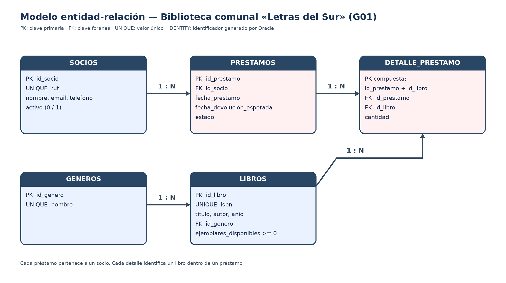

# Modelo entidad-relación — G01 Biblioteca comunal «Letras del Sur»

**Asignatura:** Back End  
**Sección:** P13-C1 (código visible en la captura entregada)  
**Grupo:** G01  
**Versión:** Borrador consolidado de Semana 1

## 1. Propósito

El modelo representa la gestión de socios, géneros, libros y préstamos de la biblioteca comunal «Letras del Sur». Contiene las cinco entidades mínimas indicadas para el grupo G01.

## 2. Diagrama

## 3. Relaciones y cardinalidades

| Relación | Cardinalidad | Descripción |
|---|---|---|
| SOCIOS — PRESTAMOS | 1:N | Un socio puede realizar varios préstamos; cada préstamo pertenece a un socio. |
| GENEROS — LIBROS | 1:N | Un género puede clasificar varios libros; cada libro pertenece a un género. |
| PRESTAMOS — DETALLE_PRESTAMO | 1:N | Un préstamo contiene una o más líneas de detalle. |
| LIBROS — DETALLE_PRESTAMO | 1:N | Un libro puede aparecer en los detalles de distintos préstamos. |

## 4. Claves

- **SOCIOS:** `id_socio` es PK; `rut` es UNIQUE.
- **GENEROS:** `id_genero` es PK; `nombre` es UNIQUE.
- **LIBROS:** `id_libro` es PK; `isbn` es UNIQUE; `id_genero` es FK hacia `GENEROS`.
- **PRESTAMOS:** `id_prestamo` es PK; `id_socio` es FK hacia `SOCIOS`.
- **DETALLE_PRESTAMO:** PK compuesta por (`id_prestamo`, `id_libro`); ambas columnas son FK hacia `PRESTAMOS` y `LIBROS`, respectivamente.

## 5. Reglas de negocio asociadas

- **R1:** No se presta un libro sin ejemplares disponibles. Al prestar se descuentan ejemplares y al devolver se reponen.
- **R2:** Un socio con un préstamo atrasado o inactivo no puede pedir otro.
- **R3:** Máximo 3 libros por préstamo y plazo de 14 días.

Los estados indicados para un préstamo son `activo`, `atrasado` y `devuelto`, con las transiciones `activo → devuelto` y `activo → atrasado → devuelto`.

## 6. Alcance y decisiones pendientes

Los nombres de las cinco entidades, sus atributos mínimos, las reglas y los estados provienen del enunciado G01. Los nombres de las PK/FK y las cardinalidades se documentan para implementar las relaciones.

El enunciado no aclara si el máximo de 3 libros cuenta ejemplares totales o títulos distintos. Tampoco especifica el mecanismo técnico que cambia un préstamo activo a atrasado. Estas dos decisiones quedan pendientes de confirmar antes de programar las validaciones; no se asume una respuesta en este documento.

No se propone una columna virtual calculada: los atributos mínimos del G01 no incluyen un cálculo equivalente al subtotal del ejemplo de ventas del manual.
